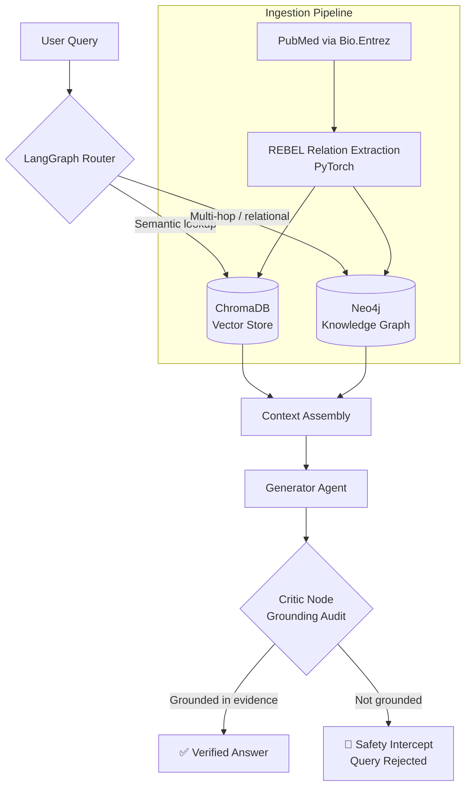

<div align="center">

# 🧬 Autonomous Multi-Agent Framework for Complex Domain-Specific Reasoning

### Graph-augmented, self-auditing RAG for high-stakes biomedical literature analysis


**MSc Advanced Computer Science · University of Leicester · CO7201**

</div>

---

## 📌 TL;DR

Standard RAG finds text that *looks similar* to a question. It struggles when the answer requires **connecting facts** across papers. This project combines **vector search + a biomedical knowledge graph** under a **LangGraph multi-agent state machine**, with a **Critic Node** that refuses to answer unless every claim is grounded in retrieved evidence.

| | Result |
|---|---|
| 🎯 **Faithfulness** | **100%**: adversarial and out-of-domain queries were intercepted instead of hallucinated |
| 🔎 **Context Recall** | **+25%** over a baseline vector-only RAG system |
| 🛡️ **Failure mode** | Safe refusal over confident fabrication |

---

## 🧩 The Problem

Vector-similarity RAG breaks down on **multi-hop reasoning** in medicine. If a system cannot connect:

> **Drug A** → *inhibits* → **Mechanism B** → *causes* → **Side Effect C**

it either misses the answer or, worse, **hallucinates a clinical outcome**. In a high-stakes domain, a fluent wrong answer is more dangerous than no answer.

## 💡 The Solution

An autonomous LLM reasoning engine built on a **LangGraph state machine** that dynamically routes each biomedical query to the right retrieval strategy, then audits its own output before responding.

- 🗄️ **Hybrid Storage:** ChromaDB for semantic retrieval **and** a local Neo4j knowledge graph for explicit relationship mapping.
- ⚙️ **Automated Ingestion:** A PyTorch-optimised pipeline using `Bio.Entrez` and a local **REBEL** relation-extraction model ingests PubMed abstracts and builds a dense knowledge graph, with resumable progress tracking.
- 🛑 **Safety Intercepts:** A **Critic Node** audits every generated response. If the output cannot be strictly grounded in the database, the agent triggers a safety intercept and rejects the query rather than hallucinating.

---

## 🏗️ Architecture



---

## 📊 Empirical Results

Evaluated with the **RAGAS** framework against a baseline vector-only RAG system.

| Metric | Baseline Vector RAG | Graph-Augmented Framework |
|---|---|---|
| **Context Recall** | Baseline | **+25% increase** |
| **Faithfulness** | n/a | **100%**, via interception of adversarial / out-of-domain queries |

> Raw experiment output is included in [`final_experiment_results.csv`](final_experiment_results.csv), and the question set in [`evaluation_dataset.json`](evaluation_dataset.json), so results can be inspected and reproduced.

**Key takeaway:** the framework trades a small amount of coverage for **safety**. It would rather say *"I can't ground this"* than invent an answer.

---

## ✨ Key Features

- **Autonomous query routing** with a LangGraph state machine
- **Hybrid retrieval**: semantic (vector) and relational (graph)
- **Local-first**: local REBEL model and local Neo4j instance, no patient or corpus data leaves your machine
- **Self-auditing**: a dedicated Critic Node enforces grounding
- **Resumable ingestion** with progress checkpointing (`ingestion_progress.json`)
- **Interactive graph visualisation** (`graph.html`)
- **Diagnostic UI** for exploring agent behaviour (`diagnostic_ui.py`)
- **Reproducible evaluation** with RAGAS, a custom evaluation dataset and a faithfulness scorer

---

## 🛠️ Tech Stack

| Layer | Technology |
|---|---|
| Orchestration | LangGraph |
| Vector store | ChromaDB |
| Knowledge graph | Neo4j |
| Relation extraction | REBEL (local, PyTorch) |
| Data source | PubMed via `Bio.Entrez` |
| Evaluation | RAGAS |
| Language | Python (plus a Java faithfulness scorer) |

---

## 📁 Repository Structure

| File | Purpose |
|---|---|
| `agent.py` | The LangGraph multi-agent reasoning engine, including router and Critic Node |
| `database_setup.py` | Initialises the vector database |
| `neo4j_kg_setup.py` | Sets up the Neo4j knowledge graph |
| `automated_ingestion.py` | PubMed ingestion and REBEL-based knowledge graph construction |
| `ingestion_progress.json` | Checkpoint file for resumable ingestion |
| `local_embedding_poc.py` | Proof of concept for local embeddings |
| `evaluator.py` | RAGAS-based evaluation harness |
| `FaithfulnessScore.java` | Faithfulness scoring utility |
| `evaluation_dataset.json` | Evaluation questions, including adversarial and out-of-domain cases |
| `run_experiment.py` | Runs the baseline vs graph-augmented experiment |
| `final_experiment_results.csv` | Final experiment results |
| `diagnostic_ui.py` | Interface for inspecting agent behaviour |
| `graph.html` | Interactive knowledge graph visualisation |
| `preliminary_report.pdf` | Preliminary project report |
| `FAQ.md` | Frequently asked questions |
| `requirements.txt` | Python dependencies |

---

## 🚀 Getting Started

### Prerequisites

- Python 3.10+
- [Neo4j](https://neo4j.com/download/) running locally (Desktop or Docker)
- A machine with enough RAM for the local REBEL model (a GPU is recommended but not required)

### Installation

```bash
git clone https://github.com/TheAamirNasir/biomedical-agent-framework.git
cd biomedical-agent-framework

python -m venv .venv
source .venv/bin/activate        # Windows: .venv\Scripts\activate

pip install -r requirements.txt
```

### Run the pipeline

```bash
# 1. Initialise the vector store and knowledge graph
python database_setup.py
python neo4j_kg_setup.py

# 2. Ingest PubMed abstracts and build the graph (resumable)
python automated_ingestion.py

# 3. Query the agent
python agent.py

# 4. Explore agent behaviour in the diagnostic UI
python diagnostic_ui.py

# 5. Reproduce the evaluation (baseline vs graph-augmented)
python run_experiment.py
```

> 💡 Ingestion is checkpointed, so if it stops you can re-run it and it will continue from where it left off.

---

## 🔬 Why This Matters

Medical question answering demands **traceability**. This framework shows that:

1. **Graphs fix what vectors miss.** Explicit relationships make multi-hop reasoning tractable.
2. **Safety can be architectural.** A dedicated auditing node makes refusal a first-class outcome rather than an afterthought.
3. **Local-first is viable.** A full extraction, retrieval and reasoning stack can run on local infrastructure.

---

## ⚠️ Limitations and Future Work

- Built on PubMed **abstracts**, not full-text papers
- Relation extraction quality is bounded by the REBEL model
- Prototype scale; not validated on clinical data
- **Future directions:** full-text ingestion, richer entity normalisation (e.g. UMLS/MeSH), larger evaluation sets, and human expert review of the Critic Node's decisions

> **Disclaimer:** This is an academic research prototype. It is **not** a medical device and must not be used for clinical decision-making or medical advice.

---

## 👤 Author

**Aamir Nasir**
MSc Advanced Computer Science, University of Leicester (Merit, 2026)

- GitHub: [@TheAamirNasir](https://github.com/TheAamirNasir)

If you find this project interesting, a ⭐ is appreciated.
